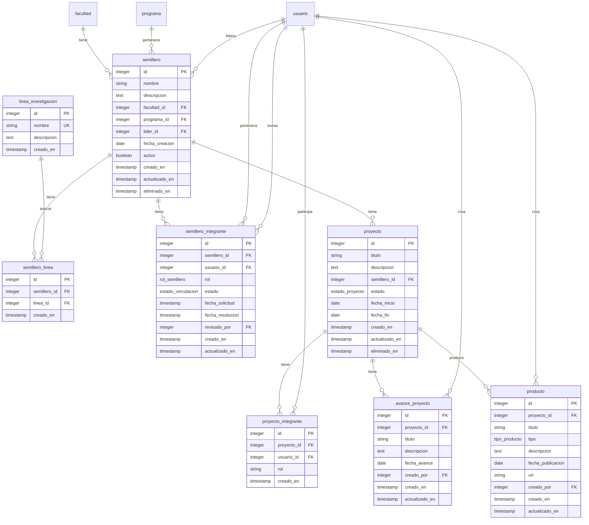
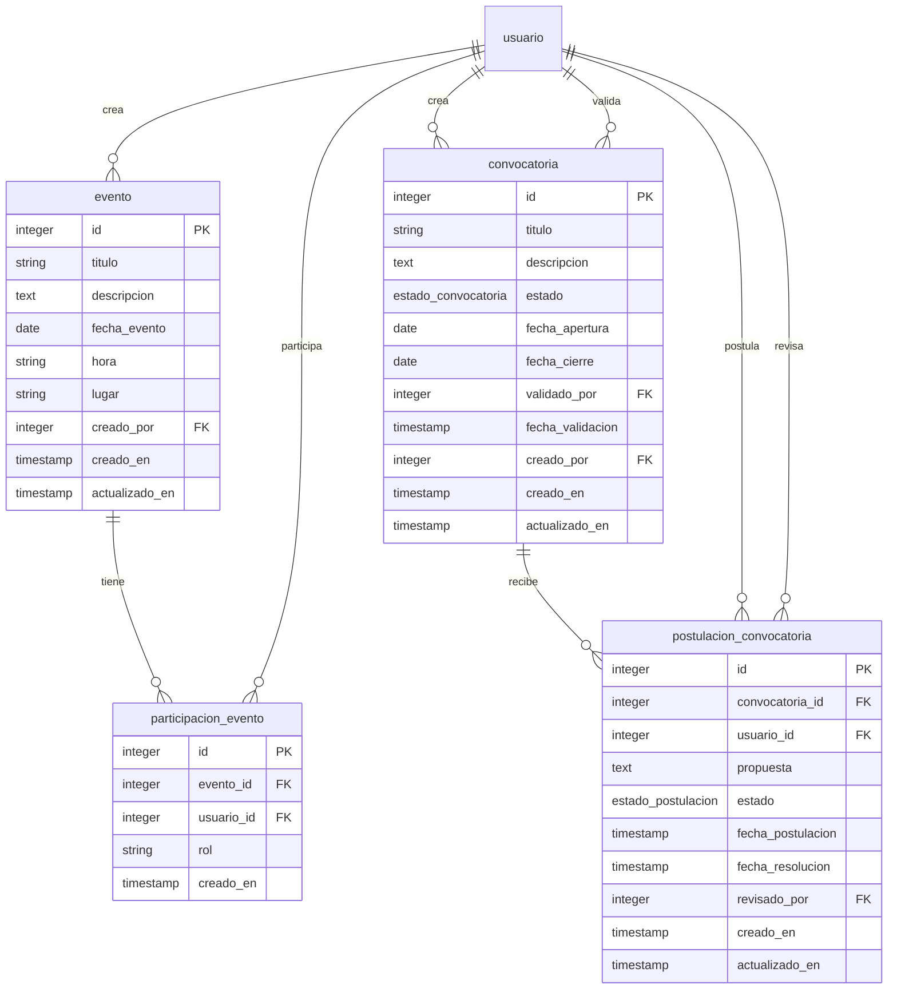
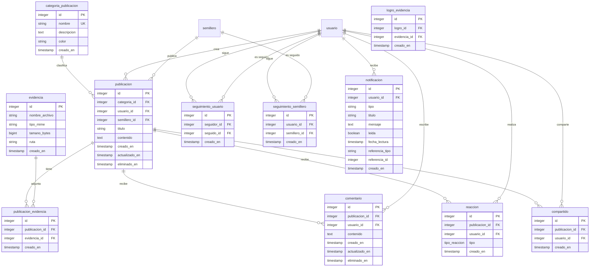
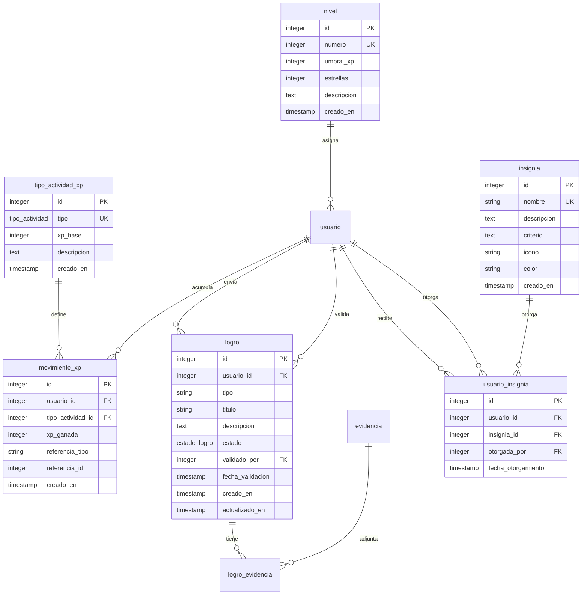

# Diagrama Entidad-Relación (ER) - RIUL

Este documento contiene el diagrama ER completo en formato Mermaid, organizado por módulos.

## Diagrama Completo

```mermaid
erDiagram
    %% ==========================================
    %% MÓDULO USUARIOS
    %% ==========================================
    rol ||--o{ usuario : "tiene"
    facultad ||--o{ programa : "tiene"
    programa ||--o{ usuario_programa : "asocia"
    usuario ||--o| usuario_programa : "tiene"
    usuario ||--o| perfil_investigador : "tiene"
    usuario ||--o| usuario : "valida"

    %% ==========================================
    %% MÓDULO INVESTIGACIÓN
    %% ==========================================
    facultad ||--o{ semillero : "tiene"
    programa ||--o{ semillero : "pertenece"
    usuario ||--o{ semillero : "lidera"
    semillero ||--o{ semillero_linea : "tiene"
    linea_investigacion ||--o{ semillero_linea : "asocia"
    semillero ||--o{ semillero_integrante : "tiene"
    usuario ||--o{ semillero_integrante : "pertenece"
    usuario ||--o{ semillero_integrante : "revisa"
    semillero ||--o{ proyecto : "tiene"
    proyecto ||--o{ proyecto_integrante : "tiene"
    usuario ||--o{ proyecto_integrante : "participa"
    proyecto ||--o{ avance_proyecto : "tiene"
    usuario ||--o{ avance_proyecto : "crea"
    proyecto ||--o{ producto : "produce"
    usuario ||--o{ producto : "crea"

    %% ==========================================
    %% MÓDULO EVENTOS Y CONVOCATORIAS
    %% ==========================================
    usuario ||--o{ evento : "crea"
    evento ||--o{ participacion_evento : "tiene"
    usuario ||--o{ participacion_evento : "participa"
    usuario ||--o{ convocatoria : "crea"
    usuario ||--o{ convocatoria : "valida"
    convocatoria ||--o{ postulacion_convocatoria : "recibe"
    usuario ||--o{ postulacion_convocatoria : "postula"
    usuario ||--o{ postulacion_convocatoria : "revisa"

    %% ==========================================
    %% MÓDULO COMUNIDAD
    %% ==========================================
    categoria_publicacion ||--o{ publicacion : "clasifica"
    usuario ||--o{ publicacion : "crea"
    semillero ||--o{ publicacion : "publica"
    publicacion ||--o{ publicacion_evidencia : "tiene"
    evidencia ||--o{ publicacion_evidencia : "adjunta"
    publicacion ||--o{ comentario : "recibe"
    usuario ||--o{ comentario : "escribe"
    publicacion ||--o{ reaccion : "recibe"
    usuario ||--o{ reaccion : "realiza"
    publicacion ||--o{ compartido : "es"
    usuario ||--o{ compartido : "comparte"
    usuario ||--o{ seguimiento_usuario : "sigue"
    usuario ||--o{ seguimiento_usuario : "es seguido"
    usuario ||--o{ seguimiento_semillero : "sigue"
    semillero ||--o{ seguimiento_semillero : "es seguido"
    usuario ||--o{ notificacion : "recibe"

    %% ==========================================
    %% MÓDULO GAMIFICACIÓN
    %% ==========================================
    tipo_actividad_xp ||--o{ movimiento_xp : "define"
    usuario ||--o{ movimiento_xp : "acumula"
    nivel ||--o{ usuario : "asigna"
    usuario ||--o{ logro : "envía"
    usuario ||--o{ logro : "valida"
    logro ||--o{ logro_evidencia : "tiene"
    evidencia ||--o{ logro_evidencia : "adjunta"
    insignia ||--o{ usuario_insignia : "otorga"
    usuario ||--o{ usuario_insignia : "recibe"
    usuario ||--o{ usuario_insignia : "otorga"

    %% ==========================================
    %% DEFINICIÓN DE ENTIDADES
    %% ==========================================

    rol {
        integer id PK
        string nombre UK
        text descripcion
        timestamp creado_en
    }

    facultad {
        integer id PK
        string nombre UK
        string codigo UK
        timestamp creado_en
    }

    programa {
        integer id PK
        integer facultad_id FK
        string nombre
        string codigo UK
        string tipo
        timestamp creado_en
    }

    usuario {
        integer id PK
        integer rol_id FK
        string nombres
        string apellidos
        string email UK
        string password_hash
        estado_cuenta estado
        integer validado_por FK
        timestamp fecha_validacion
        string documento_ruta
        integer xp_total
        integer nivel_id FK
        timestamp creado_en
        timestamp actualizado_en
        timestamp eliminado_en
    }

    perfil_investigador {
        integer id PK
        integer usuario_id FK UK
        text biografia
        text[] intereses
        string orcid
        string cvlac
        timestamp creado_en
        timestamp actualizado_en
    }

    usuario_programa {
        integer id PK
        integer usuario_id FK
        integer programa_id FK
        date fecha_inicio
        date fecha_fin
        boolean actual
        timestamp creado_en
    }

    linea_investigacion {
        integer id PK
        string nombre UK
        text descripcion
        timestamp creado_en
    }

    semillero {
        integer id PK
        string nombre
        text descripcion
        integer facultad_id FK
        integer programa_id FK
        integer lider_id FK
        date fecha_creacion
        boolean activo
        timestamp creado_en
        timestamp actualizado_en
        timestamp eliminado_en
    }

    semillero_linea {
        integer id PK
        integer semillero_id FK
        integer linea_id FK
        timestamp creado_en
    }

    semillero_integrante {
        integer id PK
        integer semillero_id FK
        integer usuario_id FK
        rol_semillero rol
        estado_vinculacion estado
        timestamp fecha_solicitud
        timestamp fecha_resolucion
        integer revisado_por FK
        timestamp creado_en
        timestamp actualizado_en
    }

    proyecto {
        integer id PK
        string titulo
        text descripcion
        integer semillero_id FK
        estado_proyecto estado
        date fecha_inicio
        date fecha_fin
        timestamp creado_en
        timestamp actualizado_en
        timestamp eliminado_en
    }

    proyecto_integrante {
        integer id PK
        integer proyecto_id FK
        integer usuario_id FK
        string rol
        timestamp creado_en
    }

    avance_proyecto {
        integer id PK
        integer proyecto_id FK
        string titulo
        text descripcion
        date fecha_avance
        integer creado_por FK
        timestamp creado_en
        timestamp actualizado_en
    }

    producto {
        integer id PK
        integer proyecto_id FK
        string titulo
        tipo_producto tipo
        text descripcion
        date fecha_publicacion
        string url
        integer creado_por FK
        timestamp creado_en
        timestamp actualizado_en
    }

    evento {
        integer id PK
        string titulo
        text descripcion
        date fecha_evento
        string hora
        string lugar
        integer creado_por FK
        timestamp creado_en
        timestamp actualizado_en
    }

    participacion_evento {
        integer id PK
        integer evento_id FK
        integer usuario_id FK
        string rol
        timestamp creado_en
    }

    convocatoria {
        integer id PK
        string titulo
        text descripcion
        estado_convocatoria estado
        date fecha_apertura
        date fecha_cierre
        integer validado_por FK
        timestamp fecha_validacion
        integer creado_por FK
        timestamp creado_en
        timestamp actualizado_en
    }

    postulacion_convocatoria {
        integer id PK
        integer convocatoria_id FK
        integer usuario_id FK
        text propuesta
        estado_postulacion estado
        timestamp fecha_postulacion
        timestamp fecha_resolucion
        integer revisado_por FK
        timestamp creado_en
        timestamp actualizado_en
    }

    categoria_publicacion {
        integer id PK
        string nombre UK
        text descripcion
        string color
        timestamp creado_en
    }

    publicacion {
        integer id PK
        integer categoria_id FK
        integer usuario_id FK
        integer semillero_id FK
        string titulo
        text contenido
        timestamp creado_en
        timestamp actualizado_en
        timestamp eliminado_en
    }

    evidencia {
        integer id PK
        string nombre_archivo
        string tipo_mime
        bigint tamano_bytes
        string ruta
        timestamp creado_en
    }

    publicacion_evidencia {
        integer id PK
        integer publicacion_id FK
        integer evidencia_id FK
        timestamp creado_en
    }

    logro_evidencia {
        integer id PK
        integer logro_id FK
        integer evidencia_id FK
        timestamp creado_en
    }

    comentario {
        integer id PK
        integer publicacion_id FK
        integer usuario_id FK
        text contenido
        timestamp creado_en
        timestamp actualizado_en
        timestamp eliminado_en
    }

    reaccion {
        integer id PK
        integer publicacion_id FK
        integer usuario_id FK
        tipo_reaccion tipo
        timestamp creado_en
    }

    compartido {
        integer id PK
        integer publicacion_id FK
        integer usuario_id FK
        timestamp creado_en
    }

    seguimiento_usuario {
        integer id PK
        integer seguidor_id FK
        integer seguido_id FK
        timestamp creado_en
    }

    seguimiento_semillero {
        integer id PK
        integer usuario_id FK
        integer semillero_id FK
        timestamp creado_en
    }

    notificacion {
        integer id PK
        integer usuario_id FK
        string tipo
        string titulo
        text mensaje
        boolean leida
        timestamp fecha_lectura
        string referencia_tipo
        integer referencia_id
        timestamp creado_en
    }

    tipo_actividad_xp {
        integer id PK
        tipo_actividad tipo UK
        integer xp_base
        text descripcion
        timestamp creado_en
    }

    movimiento_xp {
        integer id PK
        integer usuario_id FK
        integer tipo_actividad_id FK
        integer xp_ganada
        string referencia_tipo
        integer referencia_id
        timestamp creado_en
    }

    nivel {
        integer id PK
        integer numero UK
        integer umbral_xp
        integer estrellas
        text descripcion
        timestamp creado_en
    }

    logro {
        integer id PK
        integer usuario_id FK
        string tipo
        string titulo
        text descripcion
        estado_logro estado
        integer validado_por FK
        timestamp fecha_validacion
        timestamp creado_en
        timestamp actualizado_en
    }

    insignia {
        integer id PK
        string nombre UK
        text descripcion
        text criterio
        string icono
        string color
        timestamp creado_en
    }

    usuario_insignia {
        integer id PK
        integer usuario_id FK
        integer insignia_id FK
        integer otorgada_por FK
        timestamp fecha_otorgamiento
    }
```

## Vista por Módulos

### Módulo Usuarios

```mermaid
erDiagram
    rol ||--o{ usuario : "tiene"
    facultad ||--o{ programa : "tiene"
    programa ||--o{ usuario_programa : "asocia"
    usuario ||--o| usuario_programa : "tiene"
    usuario ||--o| perfil_investigador : "tiene"
    usuario ||--o| usuario : "valida"

    rol {
        integer id PK
        string nombre UK
        text descripcion
        timestamp creado_en
    }

    facultad {
        integer id PK
        string nombre UK
        string codigo UK
        timestamp creado_en
    }

    programa {
        integer id PK
        integer facultad_id FK
        string nombre
        string codigo UK
        string tipo
        timestamp creado_en
    }

    usuario {
        integer id PK
        integer rol_id FK
        string nombres
        string apellidos
        string email UK
        string password_hash
        estado_cuenta estado
        integer validado_por FK
        timestamp fecha_validacion
        string documento_ruta
        integer xp_total
        integer nivel_id FK
        timestamp creado_en
        timestamp actualizado_en
        timestamp eliminado_en
    }

    perfil_investigador {
        integer id PK
        integer usuario_id FK UK
        text biografia
        text[] intereses
        string orcid
        string cvlac
        timestamp creado_en
        timestamp actualizado_en
    }

    usuario_programa {
        integer id PK
        integer usuario_id FK
        integer programa_id FK
        date fecha_inicio
        date fecha_fin
        boolean actual
        timestamp creado_en
    }
```

### Módulo Investigación



### Módulo Eventos y Convocatorias



### Módulo Comunidad



### Módulo Gamificación



## Notas de Diseño

1. **Normalización 3FN**: El esquema está normalizado hasta tercera forma normal. No hay datos derivados duplicados (excepto `xp_total` y `nivel_id` en `usuario`, que se mantienen por triggers).

2. **Borrado lógico**: Las tablas principales (`usuario`, `semillero`, `proyecto`, `publicacion`, `comentario`) tienen `eliminado_en` para borrado lógico.

3. **Timestamps**: Todas las tablas tienen `creado_en` y las tablas modificables tienen `actualizado_en` (actualizado por trigger).

4. **Inmutabilidad**: `movimiento_xp` es inmutable (trigger impide modificaciones/eliminaciones).

5. **Índices**: Índices en todas las FK y columnas de búsqueda frecuentes (estado, fechas, nombre).

6. **Comentarios**: Todas las tablas y columnas tienen comentarios SQL (`COMMENT ON`).

7. **Polimorfismo de evidencias**: `evidencia` es una tabla central con tablas puente (`publicacion_evidencia`, `logro_evidencia`) para relacionar con diferentes entidades.
